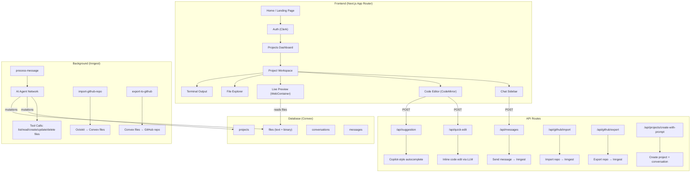

# 🌟 Polaris — Complete Project Analysis

> **"Build full-stack apps in your browser"** — An AI-native dev workspace where you describe an app, an AI agent builds it, and you preview it live in-browser, then export to GitHub.

---

## 1. What Is Polaris?

Polaris is a **browser-based AI coding platform** (think Bolt.new / v0 / Replit Agent). Users describe what they want to build in a chat interface, and an AI agent:

1. Creates/reads/updates/deletes project files
2. The project runs live in the browser via **WebContainer**
3. Users can also manually edit code in a built-in **CodeMirror** editor
4. When satisfied, they can **export the entire project to GitHub**

---

## 2. Tech Stack

| Layer                  | Technology                                                                   |
| ---------------------- | ---------------------------------------------------------------------------- |
| **Framework**          | Next.js 16 (App Router)                                                      |
| **Language**           | TypeScript                                                                   |
| **Styling**            | Tailwind CSS 4 + shadcn/ui (Radix UI primitives)                             |
| **State Management**   | Zustand (editor tabs), Convex React (real-time data)                         |
| **Database**           | Convex (real-time backend-as-a-service)                                      |
| **Authentication**     | Clerk (with Convex integration)                                              |
| **AI / LLM**           | Vercel AI SDK + OpenRouter (`openrouter/free`)                               |
| **AI Agent Framework** | Inngest Agent Kit (agentic tool-calling network)                             |
| **Background Jobs**    | Inngest (durable step functions)                                             |
| **In-Browser Runtime** | WebContainer API (runs Node.js in the browser)                               |
| **Code Editor**        | CodeMirror 6                                                                 |
| **Web Scraping**       | Firecrawl (for URL context in prompts)                                       |
| **GitHub Integration** | Octokit (import/export repos)                                                |
| **Monitoring**         | Sentry + Vercel Analytics                                                    |
| **Animations**         | Motion (Framer Motion), Rive                                                 |
| **UI Extras**          | Recharts, XY Flow (React Flow), xterm.js (terminal), allotment (split panes) |

---

## 3. Architecture Overview



---

## 4. Database Schema (Convex)

### [`schema.ts`](file:///Users/hariswarreddy/polaris/convex/schema.ts)

| Table             | Fields                                                                                                       | Purpose                                                                         |
| ----------------- | ------------------------------------------------------------------------------------------------------------ | ------------------------------------------------------------------------------- |
| **projects**      | `name`, `ownerId`, `updatedAt`, `importStatus`, `exportStatus`, `exportRepoUrl`, `settings`                  | User's projects with import/export state tracking                               |
| **files**         | `projectId`, `parentId`, `name`, `type` (file/folder), `content` (text), `storageId` (binary)                | Hierarchical file system stored in DB (text inline, binaries in Convex storage) |
| **conversations** | `projectId`, `title`, `updatedAt`                                                                            | Chat conversations tied to projects                                             |
| **messages**      | `conversationId`, `projectId`, `role` (user/assistant), `content`, `status` (processing/completed/cancelled) | Chat messages with processing status for streaming                              |

---

## 5. Core Features — Deep Dive

### 5.1 AI Chat Agent

**Flow:** User message → [`/api/messages`](file:///Users/hariswarreddy/polaris/src/app/api/messages/route.ts) → Inngest event → [`process-message`](file:///Users/hariswarreddy/polaris/src/components/features/conversations/inngest/process-message.ts)

The AI agent uses **Inngest Agent Kit** with a network/router pattern:

- **Model:** `openrouter/free` via OpenRouter
- **Max iterations:** 20 tool-call loops
- **Router logic:** Keeps looping while there are tool calls; stops when the agent produces a text-only response
- **Cancel support:** Messages can be cancelled mid-processing via `message/cancel` events
- **Auto title generation:** First message auto-generates a conversation title

**Agent Tools** (8 total in [`tools/`](file:///Users/hariswarreddy/polaris/src/components/features/conversations/inngest/tools)):

| Tool           | Description                                 |
| -------------- | ------------------------------------------- |
| `listFiles`    | List all files in the project               |
| `readFiles`    | Read content of specific files by ID        |
| `createFiles`  | Batch-create files (supports nested paths)  |
| `createFolder` | Create a folder                             |
| `updateFile`   | Update a file's content                     |
| `renameFile`   | Rename a file                               |
| `deleteFiles`  | Delete files/folders recursively            |
| `scrapeUrls`   | Scrape web URLs for context (via Firecrawl) |

### 5.2 Code Editor

- **Engine:** CodeMirror 6 with language support for JS/TS, HTML, CSS, JSON, Markdown, Python
- **Features:** One Dark theme, indentation markers, minimap
- **State:** Zustand store ([`use-editor-store.ts`](file:///Users/hariswarreddy/polaris/src/components/features/editor/store/use-editor-store.ts)) managing tabs with preview/pinned behavior (VSCode-style)
- **AI Quick Edit:** Select code → give instruction → LLM modifies just the selection ([`/api/quick-edit`](file:///Users/hariswarreddy/polaris/src/app/api/quick-edit/route.ts))
- **AI Autocomplete:** Copilot-style inline suggestions ([`/api/suggestion`](file:///Users/hariswarreddy/polaris/src/app/api/suggestion/route.ts))

### 5.3 Live Preview (WebContainer)

[`use-webcontainer.ts`](file:///Users/hariswarreddy/polaris/src/components/features/preview/hooks/use-webcontainer.ts) manages a **singleton WebContainer** that:

1. **Boots** a Node.js environment in the browser
2. **Mounts** the project's file tree (text + binary files from Convex)
3. **Runs `npm install`** (configurable install command)
4. **Runs `npm run dev`** (configurable dev command)
5. **Hot-reloads:** When files change in Convex, they're synced to the WebContainer filesystem
6. **Terminal output** is captured and displayed
7. Supports restart/teardown

### 5.4 GitHub Integration

**Import** ([`import-github-repo.ts`](file:///Users/hariswarreddy/polaris/src/components/features/projects/inngest/import-github-repo.ts)):

- Uses Octokit to fetch the repo tree (tries `main`, falls back to `master`)
- Creates folders depth-first, then imports all files
- Detects binary files with `isbinaryfile` and stores them in Convex storage
- Tracks import status: `importing` → `completed` / `failed`

**Export** ([`export-to-github.ts`](file:///Users/hariswarreddy/polaris/src/components/features/projects/inngest/export-to-github.ts)):

- Creates a new GitHub repo (public or private)
- Builds Git blobs, tree, and commit via the Git Data API
- Supports binary files (base64 encoded)
- Cancelable via `github/export.cancel` event
- Tracks export status: `exporting` → `completed` / `failed` / `cancelled`

### 5.5 File Explorer

Hierarchical file tree with:

- Create files/folders
- Rename and delete (recursive)
- Breadcrumb navigation
- Context menus

---

## 6. Route Structure

### Pages (App Router)

| Route                   | Component                                                                                                              | Description                                                            |
| ----------------------- | ---------------------------------------------------------------------------------------------------------------------- | ---------------------------------------------------------------------- |
| `/`                     | [`HomePage`](file:///Users/hariswarreddy/polaris/src/components/features/home/components/home-page.tsx)                | Landing page (unauthenticated) / redirects to projects (authenticated) |
| `/projects`             | [`ProjectsView`](file:///Users/hariswarreddy/polaris/src/components/features/projects/components/projects-view.tsx)    | Dashboard listing all user projects                                    |
| `/projects/[projectId]` | [`ProjectIdView`](file:///Users/hariswarreddy/polaris/src/components/features/projects/components/project-id-view.tsx) | Full workspace: editor + chat + preview                                |

### API Routes

| Route                              | Method | Purpose                                  |
| ---------------------------------- | ------ | ---------------------------------------- |
| `/api/messages`                    | POST   | Send a chat message → triggers AI agent  |
| `/api/messages/cancel`             | POST   | Cancel a processing message              |
| `/api/quick-edit`                  | POST   | AI-powered inline code editing           |
| `/api/suggestion`                  | POST   | AI-powered code autocomplete             |
| `/api/github/import`               | POST   | Import a GitHub repository               |
| `/api/github/export`               | POST   | Export project to GitHub                 |
| `/api/projects/create-with-prompt` | POST   | Create a new project with initial prompt |
| `/api/inngest`                     | POST   | Inngest webhook endpoint                 |

---

## 7. Component Architecture

### UI Layer (56 components in [`src/components/ui/`](file:///Users/hariswarreddy/polaris/src/components/ui))

Full shadcn/ui component library including: accordion, alert-dialog, avatar, badge, button, calendar, card, carousel, chart, checkbox, collapsible, combobox, command, context-menu, dialog, drawer, dropdown-menu, field, form, input, kbd, label, menubar, pagination, popover, progress, radio-group, resizable, scroll-area, select, separator, sheet, sidebar, skeleton, slider, sonner, spinner, switch, table, tabs, textarea, toggle, tooltip, and more.

### AI Elements (48 components in [`src/components/ai-elements/`](file:///Users/hariswarreddy/polaris/src/components/ai-elements))

A rich set of AI-specific UI components including: `prompt-input`, `message`, `code-block`, `chain-of-thought`, `reasoning`, `model-selector`, `file-tree`, `terminal`, `web-preview`, `speech-input`, `voice-selector`, `commit`, `stack-trace`, `test-results`, `schema-display`, `jsx-preview`, `sandbox`, and more.

### Feature Modules

| Module            | Location                                                                                               | Key Components                                                   |
| ----------------- | ------------------------------------------------------------------------------------------------------ | ---------------------------------------------------------------- |
| **Auth**          | [`features/auth/`](file:///Users/hariswarreddy/polaris/src/components/features/auth)                   | Auth loading view                                                |
| **Home**          | [`features/home/`](file:///Users/hariswarreddy/polaris/src/components/features/home)                   | Landing page sections (hero, features, workflow, mock workspace) |
| **Projects**      | [`features/projects/`](file:///Users/hariswarreddy/polaris/src/components/features/projects)           | Project list, navbar, file explorer, import/export dialogs       |
| **Editor**        | [`features/editor/`](file:///Users/hariswarreddy/polaris/src/components/features/editor)               | Code editor, breadcrumbs, tab navigation, editor state store     |
| **Conversations** | [`features/conversations/`](file:///Users/hariswarreddy/polaris/src/components/features/conversations) | Chat sidebar, past conversations dialog, AI agent logic          |
| **Preview**       | [`features/preview/`](file:///Users/hariswarreddy/polaris/src/components/features/preview)             | WebContainer preview, terminal, settings                         |

---

## 8. Provider Stack

[`providers.tsx`](file:///Users/hariswarreddy/polaris/src/app/providers.tsx) wraps the app with:

```
ClerkProvider
  └─ ConvexProviderWithClerk
       └─ ThemeProvider (dark mode default)
            └─ TooltipProvider
                 ├─ Authenticated → {children}
                 ├─ Unauthenticated → <HomePage />
                 └─ AuthLoading → <AuthLoadingView />
```

---

## 9. Environment & External Services

| Service              | Purpose                                    |
| -------------------- | ------------------------------------------ |
| **Clerk**            | Authentication (JWT-based)                 |
| **Convex**           | Real-time database + file storage          |
| **OpenRouter**       | LLM gateway (routing to `openrouter/free`) |
| **Inngest**          | Durable background function execution      |
| **Firecrawl**        | Web scraping for URL-referenced content    |
| **Sentry**           | Error monitoring and tracing               |
| **Vercel Analytics** | Usage analytics                            |
| **GitHub (Octokit)** | Repository import/export                   |

---

## 10. Key Design Patterns

1. **Dual Convex APIs:**
   - [`convex/*.ts`](file:///Users/hariswarreddy/polaris/convex) — Client-facing functions with Clerk auth verification
   - [`convex/system.ts`](file:///Users/hariswarreddy/polaris/convex/system.ts) — Internal API for server-side/agent use, secured by `POLARIS_CONVEX_INTERNAL_KEY`

2. **Singleton WebContainer:** Only one instance boots per browser tab (module-level variable with lazy init)

3. **Inngest Agent Kit Network:** The AI agent runs in a loop (max 20 iterations) with a router that terminates when the agent produces text without tool calls

4. **Real-time File Sync:** Files stored in Convex auto-sync to the WebContainer when they change, enabling hot-reload

5. **VSCode-style Tabs:** Preview tabs (single-click) vs. pinned tabs (double-click) managed via Zustand

6. **Binary File Support:** Images and other binary files are stored in Convex storage with separate URL resolution, then written to WebContainer as `Uint8Array`

---

## 11. Project Statistics

| Metric                       | Count |
| ---------------------------- | ----- |
| UI Components (shadcn)       | 56    |
| AI Element Components        | 48    |
| Feature Modules              | 6     |
| API Routes                   | ~8    |
| Convex Functions             | ~30   |
| AI Agent Tools               | 8     |
| Inngest Background Functions | 4     |
| npm Dependencies             | 73    |
| Database Tables              | 4     |

---

> [!IMPORTANT]
> **Security Note:** The [`.env.local`](file:///Users/hariswarreddy/polaris/.env.local) file contains real API keys and secrets. Make sure this file is in `.gitignore` and these keys are rotated if they've been exposed.
